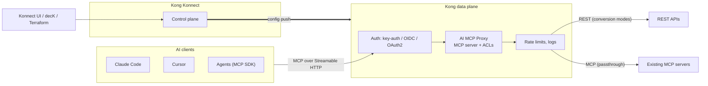
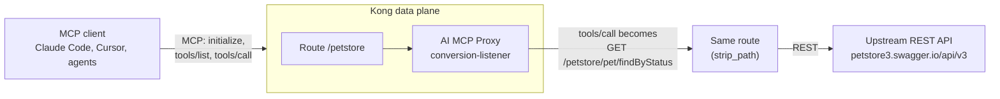

# Kong AI MCP Proxy: complete guide

Everything about Kong's **AI MCP Proxy** plugin: turn any REST API into an MCP (Model Context Protocol) server, or put governance in front of an existing MCP server, without changing the API. Includes a full configuration reference (taken from the live Kong 3.16 schema), runnable decK examples for every mode, security (key-auth, ACLs, OAuth 2.0), Terraform, a smoke-test script and client setup for Claude Code and Cursor.

> Field names, types and defaults in this repo were pulled from the plugin schema served by a Kong Konnect control plane running **Kong Gateway 3.16.0.1 Enterprise** (Serverless). Older versions may lack some fields.

## Contents

| Doc | What it covers |
| --- | --- |
| [docs/architecture.md](docs/architecture.md) | Architecture diagrams: components, data plane flow, each mode, OAuth, deployment, security layers |
| [docs/how-it-works.md](docs/how-it-works.md) | Request flow, how tool calls are routed, path resolution |
| [docs/modes.md](docs/modes.md) | The four modes, when to use each, aggregation |
| [docs/tools.md](docs/tools.md) | Defining tools: naming, paths, parameters, request bodies, responses, annotations |
| [docs/configuration-reference.md](docs/configuration-reference.md) | Every `ai-mcp-proxy` field with type, default and meaning |
| [docs/security.md](docs/security.md) | Key-auth, ACLs, consumer groups, OAuth 2.0 (AI MCP OAuth2 plugin reference) |
| [docs/sessions-and-observability.md](docs/sessions-and-observability.md) | Managed sessions (client / Redis), logging, metrics, audit logs |
| [docs/clients.md](docs/clients.md) | curl, MCP Inspector, Claude Code, Cursor |
| [docs/deploy.md](docs/deploy.md) | Konnect UI, decK, Terraform, Admin API |
| [docs/troubleshooting.md](docs/troubleshooting.md) | Every error we hit and how to fix it |

| Example | Mode / feature | Status |
| --- | --- | --- |
| [examples/01-conversion-listener-petstore.yaml](examples/01-conversion-listener-petstore.yaml) | `conversion-listener`, 6 read-only tools | Handshake and `tools/list` verified live; tool calls fixed after a verified 404 |
| [examples/02-key-auth.yaml](examples/02-key-auth.yaml) | API key on the MCP endpoint | Template |
| [examples/03-acl-consumer-groups.yaml](examples/03-acl-consumer-groups.yaml) | Per-tool ACLs by consumer group | Template |
| [examples/04-write-tools-request-body.yaml](examples/04-write-tools-request-body.yaml) | POST/PUT/DELETE tools with JSON bodies | Template |
| [examples/05-aggregation-listener.yaml](examples/05-aggregation-listener.yaml) | `conversion-only` + `listener`: many APIs, one endpoint | Template |
| [examples/06-passthrough-listener.yaml](examples/06-passthrough-listener.yaml) | Govern an existing remote MCP server | Template |
| [examples/07-oauth2.yaml](examples/07-oauth2.yaml) | OAuth 2.0 with AI MCP OAuth2 + ACL on token claims | Template |
| [terraform/](terraform/) | Example 01 in Terraform | Template; run `terraform validate` |
| [scripts/mcp-smoke-test.sh](scripts/mcp-smoke-test.sh) | initialize → tools/list → tools/call | Works against any endpoint |

"Template" means the YAML follows the live schema but has not been run against a gateway yet.

## Architecture



More diagrams (tool-call sequence, each mode, OAuth, deployment, security layers): [docs/architecture.md](docs/architecture.md).

## What the plugin does



- The plugin **is** the MCP server: it answers `initialize` and `tools/list` itself from its config.
- On `tools/call` it builds a REST request and sends it **through Kong's own routing**, so the call gets the same plugins (auth, rate limits, transforms) as any other request.
- The upstream API never sees MCP.

## Quick start (5 minutes)

Prerequisites: a Konnect control plane with a data plane (Serverless works), `deck` (`brew install kong/deck/deck`), a Konnect personal access token.

```bash
export KONNECT_TOKEN="kpat_..."
CP=serverless-api-gateway-demo           # your control plane name

deck gateway diff examples/01-conversion-listener-petstore.yaml \
  --konnect-addr https://us.api.konghq.com --konnect-token $KONNECT_TOKEN \
  --konnect-control-plane-name $CP

deck gateway sync examples/01-conversion-listener-petstore.yaml \
  --konnect-addr https://us.api.konghq.com --konnect-token $KONNECT_TOKEN \
  --konnect-control-plane-name $CP

./scripts/mcp-smoke-test.sh https://<your-proxy-url>/petstore
```

Then connect Claude Code:

```bash
claude mcp add --transport http petstore https://<your-proxy-url>/petstore
```

## Key facts

| Fact | Detail |
| --- | --- |
| Plugin name | `ai-mcp-proxy` |
| Minimum version | Kong Gateway 3.12 Enterprise (some fields need 3.13 / 3.14 / 3.16) |
| Modes | `conversion-listener`, `passthrough-listener`, `conversion-only`, `listener` |
| Transport to clients | Streamable HTTP (`text/event-stream` responses), protocol `2025-06-18` |
| Tool names | `config.tools[].name`, else a slug of `annotations.title` (`Find pets by status` → `find-pets-by-status`) |
| Tool argument names | `{in}_{name}`: `query_status`, `path_petId`, `header_x`; JSON body → `body` |
| Tool paths | No leading `/` = relative to the route path (recommended). Leading `/` = an absolute gateway path that must match some route |
| Scope | Route or Service (or global). Not Consumer / Consumer Group |
| Not part of LLM traffic | Don't stack with AI Proxy / AI guardrail plugins on the same route |
| AI Gateway 2.0 equivalent | The **MCP Server** entity (AI Gateway → MCP Servers) |

## Repository layout

```
.
├── README.md
├── docs/                 # architecture, guides and full reference
├── examples/             # decK files, one per scenario (each uses its own select_tags)
├── terraform/            # Terraform version of example 01
├── scripts/              # smoke test
├── .mcp.json.example     # Claude Code project config
└── .gitignore
```

Every example sets `_info.select_tags` with its own tag, so `deck gateway sync` on one example never deletes entities from another example or anything else in the control plane.

## References

- [AI MCP Proxy plugin](https://developer.konghq.com/plugins/ai-mcp-proxy/)
- [AI MCP OAuth2 plugin](https://developer.konghq.com/plugins/ai-mcp-oauth2/)
- [Map an API to MCP tools](https://developer.konghq.com/mcp/map-api-to-mcp-tools/)
- [AI MCP Server entity (AI Gateway 2.0)](https://developer.konghq.com/ai-gateway/entities/ai-mcp-server/)
- [Model Context Protocol specification](https://modelcontextprotocol.io/)
