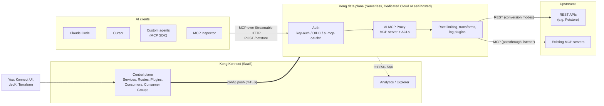
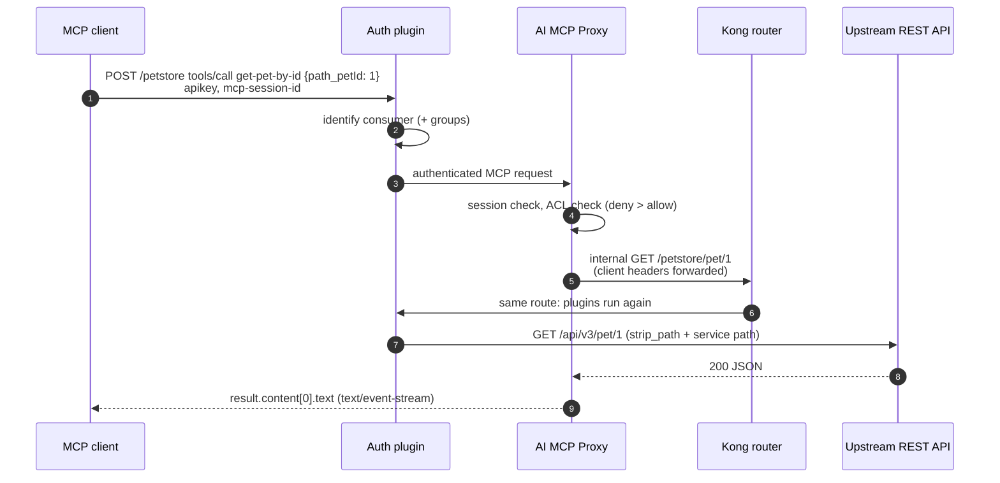
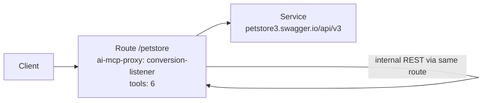
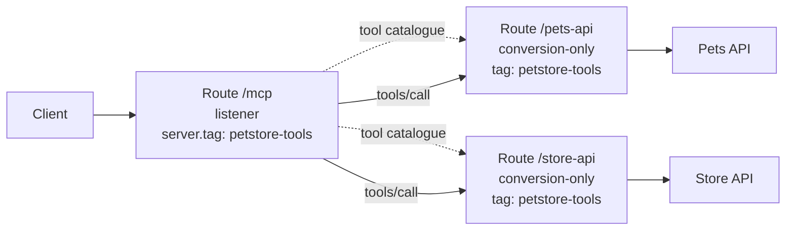
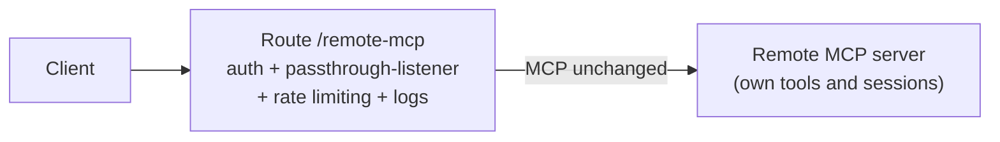
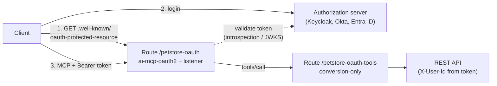
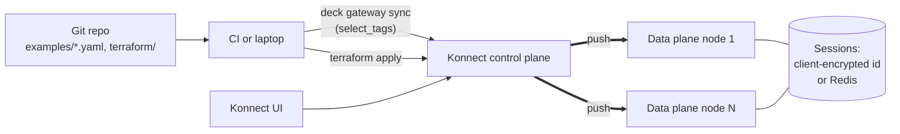
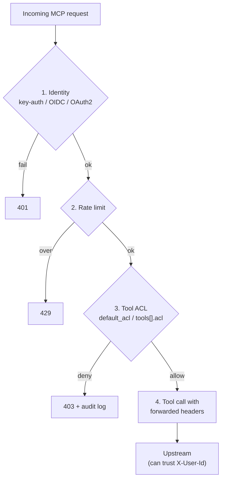

# Architecture

## 1. Big picture

AI clients speak MCP to Kong. Kong is the MCP server: it turns tool calls into REST calls (or forwards them to a real MCP server) and applies auth, ACLs, rate limits and logging on the way. You manage everything in Konnect.

| Layer | Component | Responsibility |
| --- | --- | --- |
| Clients | Claude Code, Cursor, agents | Discover tools (`tools/list`), call them (`tools/call`) |
| Management | Konnect control plane | Stores config; pushes it to data planes; never receives client traffic |
| Runtime | Kong data plane | Runs the plugins and serves the proxy URL |
| MCP | AI MCP Proxy plugin | MCP protocol, sessions, tool catalogue, REST conversion, ACLs |
| Security | key-auth / OIDC / AI MCP OAuth2, rate limiting | Identity, quotas |
| Backends | REST APIs, MCP servers | Do the actual work |
| Observability | Log plugins, Prometheus, OpenTelemetry, Konnect Analytics | MCP metrics, audit logs |

## 2. Inside the data plane: one tool call

Key point: tool calls **re-enter Kong's router**. Tool paths must resolve to a route (use relative paths), and route plugins apply to tool calls as well.

## 3. Mode architectures

### conversion-listener (one API, one endpoint)

### conversion-only + listener (many APIs, one endpoint)

### passthrough-listener (govern an existing MCP server)

### OAuth 2.0 layout (3.13+)

## 4. Deployment and configuration flow

- The **Konnect organization** is chosen by the personal access token; the control plane by name or ID. Orgs can share a display name, so check IDs.
- With several data plane nodes, use `server.session.strategy: client` or `redis` so any node can continue a session.

## 5. Security layers

## 6. Reference deployment used in this repo

| Item | Value |
| --- | --- |
| Konnect region | US (`https://us.api.konghq.com`) |
| Control plane | Serverless API Gateway |
| Kong version | 3.16.0.1 Enterprise |
| MCP endpoint | `https://<proxy-url>/petstore` |
| Upstream | `https://petstore3.swagger.io/api/v3` |
| Clients tested | curl, browser fetch (handshake + `tools/list`) |

## PNG versions

Rendered copies for viewers that don't support Mermaid: [docs/images/](images/).

| Diagram | File |
| --- | --- |
| Big picture | [architecture-overview.png](images/architecture-overview.png) |
| One tool call | [tool-call-sequence.png](images/tool-call-sequence.png) |
| conversion-listener | [mode-conversion-listener.png](images/mode-conversion-listener.png) |
| conversion-only + listener | [mode-aggregation.png](images/mode-aggregation.png) |
| passthrough-listener | [mode-passthrough.png](images/mode-passthrough.png) |
| OAuth 2.0 | [oauth-flow.png](images/oauth-flow.png) |
| Deployment | [deployment-flow.png](images/deployment-flow.png) |
| Security layers | [security-layers.png](images/security-layers.png) |
