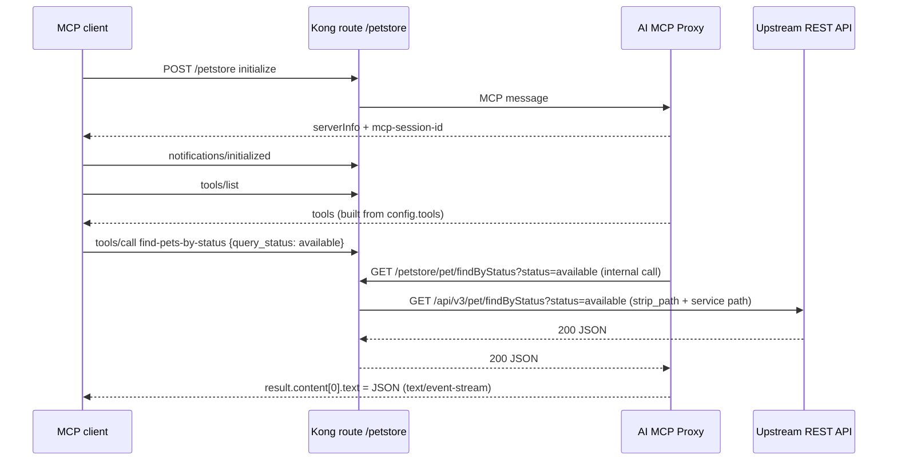

# How it works

## The pieces

| Piece | Role |
| --- | --- |
| **Gateway Service** | Where REST calls finally go (the upstream API), e.g. `https://petstore3.swagger.io/api/v3` |
| **Route** | The path clients call, e.g. `/petstore`. It is both the MCP endpoint and the path tool calls go through |
| **AI MCP Proxy plugin** | Attached to the route. Speaks MCP to clients and converts tool calls into REST |
| **Control plane** (Konnect) | Stores the config; you change it with the UI, decK or Terraform |
| **Data plane** | Runs the plugin and serves traffic at the proxy URL |

## Request flow



What to notice:

1. `initialize` and `tools/list` never reach the upstream. Kong answers them from the plugin config.
2. `tools/call` turns into an HTTP request that goes **back through Kong's router**, then to the Service.
3. Because tool calls go through the router, every plugin on the target route runs on them (rate limiting, request transformer, upstream auth headers and so on).
4. Client headers are forwarded to the tool call by default (`config.server.forward_client_headers: true`), so an `apikey` or `Authorization` header from the MCP client also reaches the internal call.

## How a tool path becomes a URL

The schema says: *"Paths not starting with '/' are treated as relative paths."* Relative to the route path.

| Route path | `strip_path` | Service URL | Tool `path` | Internal gateway call | Upstream call |
| --- | --- | --- | --- | --- | --- |
| `/petstore` | true | `https://petstore3.swagger.io/api/v3` | `pet/findByStatus` | `/petstore/pet/findByStatus` | `https://petstore3.swagger.io/api/v3/pet/findByStatus` ✅ |
| `/petstore` | true | `https://petstore3.swagger.io` | `/api/v3/pet/findByStatus` | `/api/v3/pet/findByStatus` | none: **404 no Route matched** ❌ (verified) |
| `/petstore` | true | `https://petstore3.swagger.io` | `/petstore/api/v3/pet/findByStatus` | `/petstore/api/v3/pet/findByStatus` | `https://petstore3.swagger.io/api/v3/pet/findByStatus` (absolute; should work, not tested) |

Rule of thumb: **put the API base path in the Service URL and write tool paths relative, without a leading slash.**

## Where the plugin sits in the config

```yaml
services:
  - name: petstore
    url: https://petstore3.swagger.io/api/v3   # upstream base
    routes:
      - name: petstore-mcp
        paths: [/petstore]                      # MCP endpoint + tool call prefix
        plugins:
          - name: ai-mcp-proxy                  # the MCP server
            config:
              mode: conversion-listener
              tools: [...]
```

## MCP protocol details

| Item | Value |
| --- | --- |
| Transport | Streamable HTTP: `POST` JSON-RPC to the route path; responses are `text/event-stream` with `event: message` / `data: {...}` |
| Client must send | `Content-Type: application/json` and `Accept: application/json, text/event-stream` |
| Session | `initialize` returns an `mcp-session-id` header; send it on every later request |
| Protocol version returned | `2025-06-18` |
| Server info | `{"name":"Kong","version":"3.16.0.1"}` |
| Capabilities | `tools` (`listChanged: false`) |
| Tool errors | HTTP 200 with `result.isError: true` and the upstream status in `content[0].text` |
