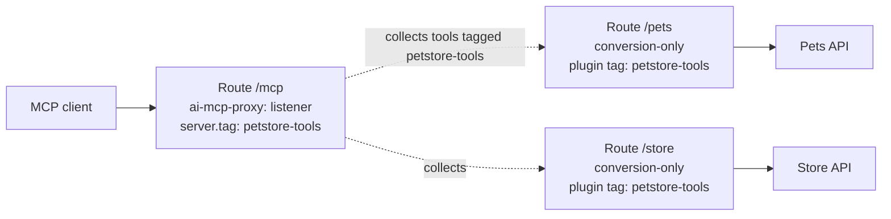
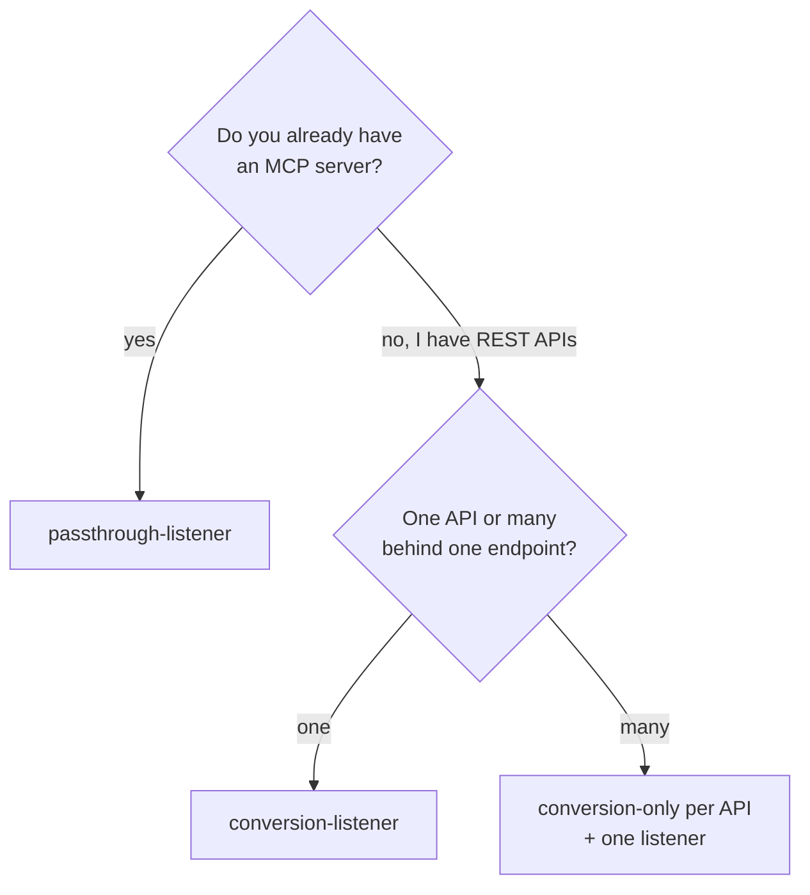

# Modes

`config.mode` is required and decides what the plugin does.

| Mode | Serves MCP to clients? | Defines tools? | Calls | Use when |
| --- | --- | --- | --- | --- |
| `conversion-listener` | Yes, on its route | Yes (`config.tools`) | REST APIs through Kong routes | One REST API → one MCP endpoint. **Start here.** |
| `passthrough-listener` | Yes, on its route | Optional (names only, for ACLs) | A remote MCP server (the Service URL) | You already have an MCP server and want auth, ACLs, metrics in front of it |
| `conversion-only` | No | Yes | — | Building blocks for a `listener` |
| `listener` | Yes, on its route | No; collects them from `conversion-only` plugins | REST APIs through Kong routes | One MCP endpoint that exposes tools from many APIs |

## conversion-listener

Converts REST operations into MCP tools and serves them on the same route.

```yaml
plugins:
  - name: ai-mcp-proxy
    config:
      mode: conversion-listener
      tools:
        - name: get-pet-by-id
          description: Get a single pet by its numeric ID.
          method: GET
          path: pet/{petId}
          parameters:
            - {name: petId, in: path, required: true, schema: {type: integer}}
```

- Must be scoped to a **route**. Without a route, conversion is skipped with a warning.
- Tool calls go through Kong's router; relative tool paths are resolved against this route.
- Full example: [examples/01-conversion-listener-petstore.yaml](../examples/01-conversion-listener-petstore.yaml).

## passthrough-listener

Proxies MCP traffic to an upstream MCP server (the Service `url`). Kong adds authentication, ACLs, logging and MCP metrics; the upstream keeps its own sessions and tool list.

```yaml
services:
  - name: remote-mcp
    url: https://mcp.example.com/mcp
    routes:
      - name: remote-mcp
        paths: [/remote-mcp]
        plugins:
          - name: ai-mcp-proxy
            config:
              mode: passthrough-listener
              tools:                        # optional: only to attach ACLs by tool name
                - name: search
                  description: Search the knowledge base
                  acl: {allow: [analysts]}
```

- `config.tools[].name` must match the remote server's tool names to apply per-tool ACLs.
- `config.server.session` does not apply; the upstream manages sessions.
- Full example: [examples/06-passthrough-listener.yaml](../examples/06-passthrough-listener.yaml).

## conversion-only + listener (aggregation)

Define tools next to each API, then publish them all through one endpoint.



1. On each API route, add `ai-mcp-proxy` with `mode: conversion-only` and a **plugin-level** `tags: [petstore-tools]`.
2. On a separate route (e.g. `/mcp`), add `ai-mcp-proxy` with `mode: listener` and `config.server.tag: petstore-tools`.
3. Clients connect only to `/mcp` and see every tagged tool.

Rules:

- `server.tag` must contain exactly one tag.
- `conversion-only` tool paths should be relative (no leading `/`) and the plugin must be on a route.
- ACL settings (`default_acl`, `include_consumer_groups`, `consumer_identifier`, `acl_attribute_type`) go on the **listener**, not on `conversion-only` plugins; per-tool `acl` blocks stay on the tools.
- Full example: [examples/05-aggregation-listener.yaml](../examples/05-aggregation-listener.yaml).

## Choosing a mode



## Combining with other plugins

| Combine with | OK? | Note |
| --- | --- | --- |
| Key Auth, OpenID Connect, ACL, Rate Limiting | Yes | Put them on the MCP route |
| AI MCP OAuth2 | Yes, with care | From 3.13 it treats **all** traffic on its route as MCP, so don't put it on a route with `conversion-listener` (internal tool calls would be rejected). Use `listener` / `passthrough-listener` on the OAuth route and keep `conversion-only` on separate routes |
| AI Proxy, AI Prompt Guard, other LLM plugins | No | MCP traffic is not LLM traffic; keep them on different routes |
