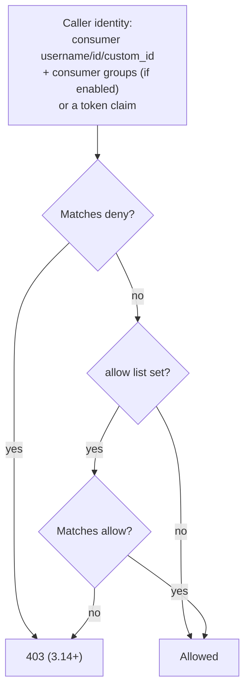

# Security

An MCP endpoint with no auth lets anyone run your tools. Layer these:

| Layer | Plugin / setting | Answers |
| --- | --- | --- |
| Who is calling | Key Auth, OpenID Connect, or AI MCP OAuth2 | Is this a known client? |
| What they may use | `default_acl` and `tools[].acl` in AI MCP Proxy | Which tools can this caller see and call? |
| How much | Rate Limiting (Advanced) | How often? |
| What the upstream needs | Request Transformer, upstream auth on the route | How does Kong authenticate to the API? |

## 1. API key (simplest)

```yaml
plugins:
  - name: key-auth
    config:
      key_names: [apikey]
consumers:
  - username: claude-code
    keyauth_credentials:
      - key: ${{ env "DECK_CLAUDE_CODE_KEY" }}
```

- Put `key-auth` on the **same route** as the MCP plugin.
- Clients send `apikey: <key>`. Because `forward_client_headers` defaults to `true`, the key also rides along on internal tool calls, which go through the same route.
- Example: [examples/02-key-auth.yaml](../examples/02-key-auth.yaml).

## 2. Tool ACLs

The plugin evaluates ACLs itself; you do not need the separate ACL plugin.

```yaml
config:
  mode: conversion-listener
  include_consumer_groups: true        # allow group names in ACL lists
  consumer_identifier: username        # consumer entries are usernames
  default_acl:
    - scope: tools
      allow: [readers, admins]         # everyone in these groups sees all tools...
      deny: [suspended]
  tools:
    - name: delete-pet
      description: Permanently delete a pet.
      method: DELETE
      path: pet/{petId}
      acl:
        allow: [admins]                # ...except this one: admins only
```

### Evaluation



| Rule | Detail |
| --- | --- |
| Deny wins | A match in `deny` always rejects |
| Per-tool replaces default | If a tool has `acl`, `default_acl` is ignored for that tool (not merged) |
| `tools/list` is filtered | Callers only see tools they may call |
| Needs an identity | ACLs need an authenticated consumer (key-auth, OIDC) or a token claim |
| Where to configure | `include_consumer_groups`, `consumer_identifier`, `acl_attribute_type`, `default_acl` on **listener-type** modes, not `conversion-only` |
| Error code | HTTP 403 from 3.14; earlier JSON-RPC `-32602` |
| Audit | `logging.log_audits: true` logs every allow/deny decision |

Example: [examples/03-acl-consumer-groups.yaml](../examples/03-acl-consumer-groups.yaml).

### ACL on OAuth token claims

```yaml
config:
  acl_attribute_type: oauth_access_token
  access_token_claim_field: .groups        # jq path into the token; strings or arrays
  default_acl:
    - scope: tools
      allow: [mcp-users]
```

## 3. OAuth 2.0 with the AI MCP OAuth2 plugin (tech preview)

Makes Kong an OAuth 2.0 **resource server** following the MCP authorization spec. MCP clients that support OAuth (Claude Code, Cursor) discover your identity provider from the protected-resource metadata and run the login flow themselves.

```yaml
plugins:
  - name: ai-mcp-oauth2
    config:
      resource: https://<proxy-url>/petstore-oauth
      authorization_servers:
        - https://login.example.com/realms/mcp
      scopes_supported: [mcp.read]
      # token validation: introspection (opaque tokens) OR JWKS (JWTs, discovered if omitted)
      introspection_endpoint: https://login.example.com/realms/mcp/protocol/openid-connect/token/introspect
      client_id: kong-mcp
      client_secret: ${{ env "DECK_OAUTH_CLIENT_SECRET" }}
      client_auth: client_secret_basic
      consumer_claim: [sub]
      consumer_optional: true
```

| Field | Default | Meaning |
| --- | --- | --- |
| `resource` **R** | — | Resource identifier (usually the MCP endpoint URL) |
| `authorization_servers` **R** | — | Issuer URLs advertised to clients |
| `metadata_endpoint` | `$resource/.well-known/oauth-protected-resource` | Protected-resource metadata path. Must be covered by the same route |
| `scopes_supported` | — | Advertised scopes |
| `introspection_endpoint` / `mtls_introspection_endpoint` | — | Validate opaque tokens. If omitted, JWKS is used |
| `jwks_endpoint` | discovered | JWKS URL for JWT validation |
| `metadata_discovery_endpoint` | — | Custom authorization server metadata URL |
| `client_id` / `client_secret` / `client_auth` | — | Credentials for introspection. `client_auth`: `client_secret_basic`, `client_secret_post`, `client_secret_jwt`, `private_key_jwt`, `tls_client_auth`, `self_signed_tls_client_auth`, `none` |
| `client_jwk` / `client_alg` | — | For `private_key_jwt` / `client_secret_jwt` |
| `tls_client_auth_cert` / `tls_client_auth_key` / `tls_client_auth_ssl_verify` | — / — / `true` | mTLS client auth |
| `cache_introspection` | `true` | Cache introspection results |
| `jwks_cache_ttl` / `metadata_cache_ttl` | `3600` / `3600` | Cache lifetimes (s) |
| `metadata_discovery_retry` | `3` | Retries per discovery URL |
| `jwt_claims_leeway` | `0` | Clock skew (s) for `exp` / `nbf` |
| `insecure_relaxed_audience_validation` | `false` | Skip audience check (only if your IdP sets `aud` wrongly) |
| `consumer_claim` / `consumer_by` / `consumer_optional` | — / `[username, custom_id]` / `false` | Map a claim to a Kong consumer |
| `consumer_groups_claim` / `consumer_groups_optional` | — / `false` | Map a claim to consumer groups |
| `credential_claim` | `[sub]` | Virtual credential for rate limiting when no consumer is mapped |
| `claim_to_header[]` (`claim`, `header`) | — | Copy top-level claims to upstream headers |
| `upstream_headers[]` (`header`, `path[]`) | — | Copy nested claims to headers (3.14+; exclusive with `claim_to_header`) |
| `passthrough_credentials` | `false` | Keep the token on the upstream request (stripped by default) |
| `token_exchange.*` | disabled | RFC 8693 token exchange before calling the upstream: `enabled`, `token_endpoint` **R**, `client_auth` (`client_secret_basic` / `client_secret_post` / `none` / `inherit`), `request.resource` / `audience` / `scopes` / `actor_token_source` (`header` / `config` / `none`), `cache.enabled` (`true`), `cache.ttl` (`3600`). Needs `passthrough_credentials: true` |
| `ssl_verify` / `timeout` / `keepalive` / `http_version` | `true` / `10000` / `true` / `1.1` | HTTP client settings |
| `http_proxy` / `https_proxy` / `no_proxy` (+ `*_authorization`) | — | Outbound proxy |
| `args` / `headers` | — | Extra POST args / headers for introspection |
| `introspection_format` | — | `string`, `base64`, `base64url` |
| `max_request_body_size` | `8192` | Max MCP body this plugin reads |

**Important (3.13+):** the OAuth2 plugin treats all traffic on its route as MCP. Kong's internal tool calls from `conversion-listener` go through the same route and would be rejected. Put OAuth2 on a route running `listener` (or `passthrough-listener`) and keep `conversion-only` tools on other routes. Example: [examples/07-oauth2.yaml](../examples/07-oauth2.yaml).

## 4. Rate limiting

```yaml
plugins:
  - name: rate-limiting
    config:
      minute: 60
      policy: local
      limit_by: consumer
```

MCP client pings count as requests. Each `tools/call` also produces an internal request through the route, so one tool call can count twice on a route-level limit; size limits accordingly.

## Checklist

- [ ] Auth plugin on every MCP route
- [ ] `default_acl` set; destructive tools restricted with per-tool `acl`
- [ ] `destructive_hint: true` on tools that delete or overwrite
- [ ] `log_payloads: false` unless debugging
- [ ] Secrets via `${{ env "DECK_..." }}` or a vault, never committed
- [ ] Rate limit on the MCP route
